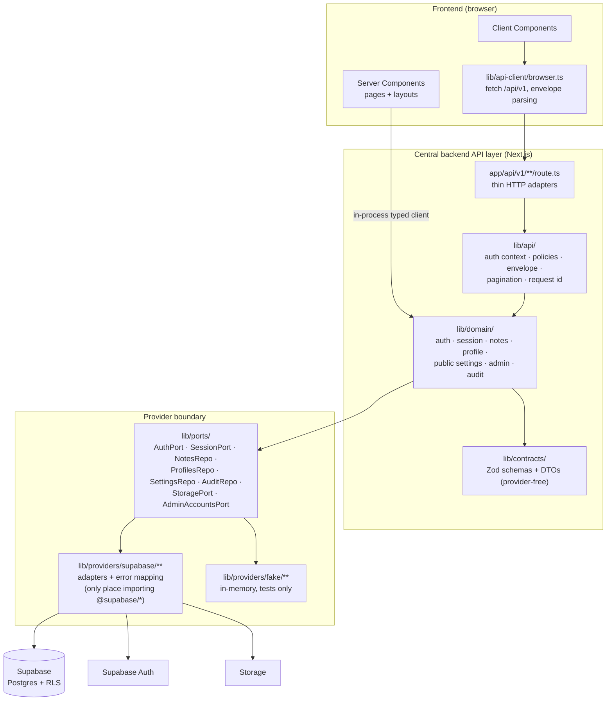

# UrSpace — API Architecture (Phase 4, revised)

**Status:** implemented 2026-11-27. The API layer, all module routes and the
frontend migration are in the repository. Authenticated endpoint cases remain
unverified until a dedicated test account exists (§10).

**Authentication exception (2026-11-27):** the login system is out of scope by
explicit instruction. Signup, password login, logout, password recovery and
Google/GitHub OAuth stay on the existing Server Actions and Supabase browser
client. The API only *reads* the existing session; it never creates, refreshes
or replaces one.
**Supersedes:** the notes-only v1 of this document.
**Companion:** [API_MIGRATION.md](API_MIGRATION.md) — full Supabase interaction
inventory, module coverage matrix, phased migration, provider-swap playbook.

This revision widens the goal: UrSpace moves to an **API-driven architecture**
for every application module, so the frontend depends on our own backend
contract rather than on Supabase, and the data/auth/storage provider can be
replaced behind that contract.

---

## 1. Goal and principles

1. **One backend API layer.** All reads and writes for application data go
   through a central backend layer inside this Next.js app: contracts, domain
   services, provider adapters and HTTP handlers.
2. **The frontend never imports `@supabase/*` and never calls Supabase.** After
   migration, the only Supabase imports live in `lib/providers/supabase/**`.
   Today the browser imports it for OAuth; that path moves behind our API.
3. **Provider-neutral domain.** Business rules (ownership, roles, validation,
   audit) live in domain services and must not depend on PostgREST, RLS helper
   functions or Supabase SDK types.
4. **One contract, several transports.** The browser calls `/api/v1` over HTTP.
   Server Components call the same domain services in-process through a typed
   server client. Both consume the same Zod contracts and DTOs.
5. **RLS stays, but is not the only lock.** Supabase RLS remains
   defence-in-depth. Explicit ownership and role checks live in the domain so
   that replacing the database cannot silently remove authorization.
6. **Migrate by module, never big-bang.** Each module ships behind the same
   contract, with the previous path kept until the new one is verified.

### Non-goals (this phase)

- No separate microservice, queue or GraphQL layer.
- No schema, policy or auth-provider change.
- No external/third-party API consumers yet.
- No new product features. This is a refactor of access paths.

---

## 2. Target architecture



### 2.1 Layer responsibilities

| Layer | Owns | Must not |
| --- | --- | --- |
| `app/**` (pages, components) | Rendering, form UX, local UI state | Import Supabase, provider adapters, or query the DB |
| `lib/api-client/**` | The caller-side contract: request building, envelope parsing, typed results | Contain business rules |
| `app/api/v1/**` | HTTP concerns: method, status, headers, body parsing, calling one domain operation | Query the database or contain business rules |
| `lib/api/**` | Authentication context, route policies, error mapping, pagination, request ids | Know about notes/tutors specifically |
| `lib/domain/**` | Business rules, ownership, role checks, orchestration, audit decisions | Import `@supabase/*`, read `process.env` provider keys, or know HTTP status codes |
| `lib/contracts/**` | Zod input schemas, DTO types, enums (`Role`, `OAuthProvider`), pagination shapes | Import server-only modules or provider SDKs |
| `lib/ports/**` | Interfaces for persistence, identity and storage | Leak SQL/PostgREST shapes |
| `lib/providers/supabase/**` | SDK calls, cookie handling, error translation, RLS-scoped and service-role clients | Contain business rules or return raw provider errors |

### 2.2 Dependency rule (enforceable)

```
app/**, components/**  ──▶  lib/api-client, lib/contracts
app/api/v1/**          ──▶  lib/api, lib/contracts
lib/domain/**          ──▶  lib/ports, lib/contracts
lib/providers/**       ──▶  lib/ports, lib/contracts, @supabase/*
proxy.ts               ──▶  lib/domain/session (via SessionPort)
```

Forbidden everywhere except `lib/providers/supabase/**` and `proxy.ts`'s
session adapter call: `@supabase/ssr`, `@supabase/supabase-js`,
`lib/providers/**`. Enforced in Phase 6 with ESLint `no-restricted-imports` plus
a CI grep; enforced by review from Phase 1.

### 2.3 Two transports, one contract

| Caller | Path | Why |
| --- | --- | --- |
| Client components and external clients | HTTP → `/api/v1/**` | One stable, testable, versioned contract |
| Server Components | `lib/api-client/server.ts` → domain services in-process | No self-HTTP hop, no cookie forwarding, no duplicate auth check |
| Postman / scripts | HTTP → `/api/v1/**` with a cookie jar | Exercises the same contract as the browser |

The server client is deliberately thin: it authenticates from the incoming
request, calls the same domain function the route handler calls, and returns the
same DTO. If the backend is ever extracted from Next.js, only
`lib/api-client/server.ts` changes (to HTTP); pages do not.

---

## 3. Contract conventions

These apply to every module, so clients can use one parser and one error
handler.

### 3.1 Envelope

```json
{ "data": { }, "meta": { } }
```

- `data` is an object, an array, or `null` (session probe).
- `meta` appears on collections: `{ page, limit, total, pageCount }`.
- No other top-level keys. No bare arrays.

### 3.2 Errors

```json
{
  "error": {
    "code": "validation_error",
    "message": "The request body is invalid.",
    "details": { "title": ["Add a title before saving."] },
    "requestId": "b0a1f3c2-5f0e-4a51-9d7c-1f2e3a4b5c6d"
  }
}
```

| Status | `code` | Meaning |
| --- | --- | --- |
| 400 | `validation_error` | Shape, type, unknown field, bad id |
| 401 | `unauthenticated` | No valid session or token |
| 403 | `forbidden` | Authenticated, policy denies the action |
| 403 | `account_suspended` | Valid identity, suspended account |
| 403 | `csrf_origin_mismatch` | Cookie-auth mutation from a foreign origin |
| 404 | `not_found` | Missing resource **or** resource outside the caller's scope |
| 409 | `conflict` | Uniqueness/state conflict (e.g. email already exists) |
| 413 | `payload_too_large` | Per-route body limit exceeded |
| 415 | `unsupported_media_type` | Wrong or missing `Content-Type` |
| 429 | `rate_limited` | Reserved; not implemented yet |
| 503 | `unavailable` | Provider temporarily unreachable |
| 500 | `internal_error` | Unexpected; generic message + `requestId` |

Resource existence is not disclosed across ownership boundaries: another
user's note is `404`, never `403`.

### 3.3 Common headers

| Header | Value |
| --- | --- |
| `Content-Type` | `application/json; charset=utf-8` (absent on 204) |
| `Cache-Control` | `private, no-store` for authenticated data |
| `Vary` | `Cookie, Authorization` when credentials are accepted |
| `X-Request-Id` | server UUID, echoed on every 4xx/5xx |
| `Location` | on 201 responses |

### 3.4 Input rules

- JSON objects are `.strict()`: unknown keys are rejected, so `user_id`,
  `role`, `account_status` can never be mass-assigned.
- Ids are validated as UUIDs before reaching the provider.
- Limits are explicit per route (notes 256 KB; bulk import 2 MB; avatar 2 MB).
- Dates are ISO 8601 UTC strings; ids are opaque strings to clients.
- Field names are camelCase on the wire; providers map to snake_case internally.

### 3.5 Authentication

Canonical: **HttpOnly session cookie**, set by our API and refreshed by
`proxy.ts` through the session adapter. The frontend never reads or inspects it.

Transitional: `Authorization: Bearer <Supabase access token>` supported by the
current adapter so the Notes API can be tested in Postman before the auth
module moves in Phase 3. It is not used by the browser. It is reviewed in
Phase 6 and kept only if it still has a maintained purpose. Cookie-authenticated
mutations require a same-origin `Origin`; bearer requests are exempt.

---

## 4. Module coverage — every endpoint

Legend: **P1** foundation, **P2** notes, **P3** identity, **P4** public &
shell, **P5** admin, **P6** decommission. Phase detail is in
[API_MIGRATION.md](API_MIGRATION.md).

### 4.1 Authentication and session (implemented scope)

The login system is **not** migrated. These paths remain exactly as they were:

- `app/auth/actions.ts` — signup, password login, logout, forgot/reset.
- `components/social-auth-buttons.tsx` — Google/GitHub and the other providers,
  using the browser Supabase client.
- `app/auth/callback/route.ts`, `app/auth/confirm/route.ts`,
  `lib/auth-callback.ts` and `proxy.ts`.

| Method | Path | Access | Purpose |
| --- | --- | --- | --- |
| GET | `/api/v1/auth/session` | optional | Resolve the existing cookie or bearer session: `{ user, profile, via }`, or `null` fields when signed out |

API-side session verification reads the same Supabase cookies. There is no
login, signup, logout, OAuth-start or password-reset endpoint, by design.

### 4.2 Current user (P3)

| Method | Path | Access | Purpose |
| --- | --- | --- | --- |
| GET | `/api/v1/me` | session | Profile, role, status |
| PATCH | `/api/v1/me` | session | Display name (1–60 chars) |
| PUT | `/api/v1/me/password` | session | Change password |
| POST | `/api/v1/me/avatar` | session | Multipart upload; JPEG/PNG/WebP ≤ 2 MB |
| DELETE | `/api/v1/me/avatar` | session | Remove photo |

`GET/PATCH /api/v1/me/preferences` is **deferred**: theme and wallpaper are
`localStorage` today and `user_preferences` is unused. Do not invent a
server-side preference API before the feature exists.

### 4.3 Notes (P2)

| Method | Path | Access | Purpose |
| --- | --- | --- | --- |
| GET | `/api/v1/notes` | session | Own notes; `page`, `limit`, `q` (title), `tag` |
| POST | `/api/v1/notes` | session | Create; `201` + `Location` |
| GET | `/api/v1/notes/{id}` | session | Own note |
| PATCH | `/api/v1/notes/{id}` | session | Partial update; at least one field |
| DELETE | `/api/v1/notes/{id}` | session | `204` |
| POST | `/api/v1/notes/import` | session | One-time legacy import, ≤ 500 notes, 2 MB |

`/api/v1/notes` is always the caller's own collection, including for staff.
Tiptap allowlist and tag normalisation are reused unchanged.

### 4.4 Public settings (P4)

| Method | Path | Access | Purpose |
| --- | --- | --- | --- |
| GET | `/api/v1/public/settings` | none | `{ allowPublicSignup, platformNotice }` |

This replaces the current `components/platform-notice.tsx` →
`lib/admin.ts` import. Public UI must not depend on the admin data module.

### 4.5 Administration — tutors and accounts (implemented)

| Method | Path | Access | Purpose |
| --- | --- | --- | --- |
| GET | `/api/v1/admin/overview` | staff | Counts + recent notes + recent activity |
| GET | `/api/v1/admin/tutors` | staff | `page`, `pageSize`, `q`, `status` |
| POST | `/api/v1/admin/tutors` | staff | Create a tutor, or an administrator when the caller is the owner |
| GET | `/api/v1/admin/tutors/{id}` | staff | Tutor detail |
| PATCH | `/api/v1/admin/tutors/{id}` | staff | Display name and/or `accountStatus` |
| GET | `/api/v1/admin/tutors/{id}/notes` | staff | Paginated tutor notes |
| GET | `/api/v1/admin/accounts` | owner | List administrators |
| POST | `/api/v1/admin/accounts` | staff | Create an account (`tutor`, or `admin` for the owner) |
| POST | `/api/v1/admin/accounts/{id}/reset` | staff | Send a password reset link |
| PATCH | `/api/v1/admin/accounts/{id}/role` | owner | Change `tutor` ↔ `admin` |

Combining rename and suspend into one `PATCH` keeps the resource contract
stable. Domain policies are preserved: owner rows are untouchable, no
self-modification, administrators are limited to tutors.

### 4.6 Administration — notes, activity, settings (implemented)

| Method | Path | Access | Purpose |
| --- | --- | --- | --- |
| GET | `/api/v1/admin/notes` | staff | `page`, `pageSize`, `q`, `tutorId` |
| GET | `/api/v1/admin/notes/{id}` | staff | Note + owner |
| PATCH | `/api/v1/admin/notes/{id}` | staff | Edit a tutor-owned note |
| DELETE | `/api/v1/admin/notes/{id}` | staff | Delete; audited |
| GET | `/api/v1/admin/activity` | staff | Paginated audit log |
| GET | `/api/v1/admin/settings` | owner | Signup toggle + platform notice |
| PUT | `/api/v1/admin/settings` | owner | Update both settings |

`audit_logs` is never writable over HTTP. Entries are appended by the domain
layer (a single policy, replacing today's inconsistent auditing where tutor note
CRUD is not recorded but admin edits are).

### 4.7 Not exposed

- `user_preferences` (no feature).
- Audit log writes, account provisioning internals, service-role operations.
- Storage object listing or arbitrary upload paths.
- Any direct PostgREST-shaped query surface (`select`, `filter` parameters).

---

## 5. Cross-cutting backend rules

### 5.1 One route wrapper

Every handler goes through the same wrapper:

```ts
export const POST = route(
  { roles: ["owner", "admin"], sameOrigin: true, limit: "json" },
  async ({ auth, body }) => {
    const note = await notes.create(auth, createNoteSchema.parse(body));
    return created(note, { location: `/api/v1/notes/${note.id}` });
  },
);
```

The wrapper performs: request id → authentication → suspension check → role
policy → origin check → body size/type → schema parse → service call →
`DomainError` mapping → envelope. Handlers contain no try/catch boilerplate and
cannot forget a status code.

### 5.2 Authorization

1. **Authentication** resolves an `AuthContext { userId, profile, providerClientRef }`.
2. **Route policy** checks role membership (`staff`, `owner`).
3. **Service policy** checks the resource: note ownership, tutor-vs-admin target
   rules, no self-modification, owner protection.
4. **Provider policy** (RLS) re-checks rows as the last line.

Only the domain layer decides *who may do what*; the provider only enforces what
it can. This keeps authorization intact if Supabase is replaced.

### 5.3 Validation

- Zod schemas in `lib/contracts`, shared by browser forms, HTTP handlers and
  services.
- Note bodies use `parseNoteBody`; links remain protocol-allowlisted.
- Provider inputs are parameterised by the adapter; no string-built filters
  beyond the existing `ilike` sanitisation helper.

### 5.4 Errors and observability

- Providers translate their errors (`PGRST116`, `23505`, auth errors) into
  `DomainError` kinds: `not_found`, `conflict`, `unauthorized`, `unavailable`,
  `unknown`. Raw provider messages never reach a response.
- 5xx bodies carry `requestId`; logs carry route, method, status, duration and
  code — never note content, emails or tokens.
- Audit writes are best-effort and never fail the user operation, as today.

### 5.5 Caching and performance

- Authenticated responses: `private, no-store`.
- RSC reads stay server-rendered (PPR); `router.refresh()` after mutations keeps
  the current model.
- No RSC self-fetch: the server client calls the domain in-process. This avoids
  an extra network hop and cookie re-serialisation.
- Public settings may later get a short `s-maxage`; not before the cache policy
  is reviewed.

### 5.6 Rate limiting and abuse (gap)

Not implemented in the migration. Per-route limits need shared storage
(e.g. Upstash Redis) and belong to a separate change. Until then: body caps,
pagination caps, and Vercel platform protections. Recorded as a known gap, not
assumed away.

---

## 6. Provider boundary

### 6.1 Ports

| Port | Operations (domain language) |
| --- | --- |
| `AuthPort` | signUp, signIn, signOut, requestPasswordReset, resetPassword, changePassword, startOAuth, exchangeCode, resolveSession, refreshSession |
| `NotesRepo` | listByOwner, findOwned, create, updateOwned, deleteOwned, listByTutor, search, count, countSince, createMany |
| `ProfilesRepo` | findById, updateName, updateAvatar, listTutors, listAdmins, countByRole |
| `SettingsRepo` | getPublic, getAll, upsert |
| `AuditRepo` | append, list |
| `StoragePort` | upload, remove, publicUrl, keyFromUrl |
| `AdminAccountsPort` | createUser(role), sendResetLink |

Ports return domain DTOs (`Profile`, `Note`, `Page<T>`), never
`PostgrestSingleResponse` or SQL rows. Adapters map both directions.

### 6.2 What a provider swap touches

| Surface | Change required | Frontend impact |
| --- | --- | --- |
| Database | New repositories + migrations; RLS replaced or re-created | None — contract unchanged |
| Auth | New `AuthPort`; session cookie format | Users sign in again once; UI unchanged |
| Storage | New `StoragePort`; object copy | Existing avatar URLs may need a media route or re-upload |
| Provisioning | New `AdminAccountsPort` | None |
| Env vars | Adapter-only names | None (frontend never sees them) |

Because RLS is Supabase-specific, the domain must own authorization. That is
already the design (explicit owner scoping and role checks), and it is a
precondition for any swap.

### 6.3 Known provider couplings to remove

- `components/social-auth-buttons.tsx` imports `@supabase/supabase-js` types and
  the browser client (P3).
- `proxy.ts` constructs `createServerClient` directly (P1 wrapper, P6 move).
- `next.config.ts` derives image hosts from `NEXT_PUBLIC_SUPABASE_URL` (P3/P6).
- `avatar_url` stores an absolute Supabase URL; `StoragePort.keyFromUrl` makes it
  provider-neutral, with a media route only if a swap is scheduled.
- `NEXT_PUBLIC_SUPABASE_*` names expose provider identity to the bundle; rename
  to server-only `SUPABASE_URL` / `SUPABASE_PUBLISHABLE_KEY` after the browser
  client is removed.
- `db/schema.sql` mixes schema and provider-specific RLS; move under
  `lib/providers/supabase/db/` in P6.

---

## 7. Frontend integration model

| Concern | Today | Target |
| --- | --- | --- |
| Session | Supabase cookies read by `lib/auth.ts` | Session domain + adapter; pages call `requireUser()` unchanged in behaviour |
| Reads | RSC → `lib/notes.ts` / `lib/admin.ts` | RSC → `lib/api-client/server` → domain |
| Writes | Server Actions → Supabase | Client → `fetch('/api/v1/...')`; Server Actions removed by P6 |
| OAuth | Browser Supabase SDK | **Unchanged** — explicitly out of scope |
| Login/signup/logout/reset | Server Actions | **Unchanged** — explicitly out of scope |
| Public settings | Public component → admin DAL | `serverApi.settings.public()` (short-TTL cache) |
| Errors | Action state strings | Envelope `code` + `details`, mapped to the same messages |

Trade-off: moving forms to `fetch` loses no-JS progressive enhancement. For a
signed-in, JavaScript-dependent editor this is acceptable; it is called out
rather than hidden. Forms keep `useActionState`-style field errors by consuming
`validation_error.details`.

---

## 8. Postman

[POSTMAN.md](POSTMAN.md) is updated for the app-wide scope: cookie-first auth,
the transitional bearer bridge, per-module folders, and the growing test matrix.
The importable collection currently covers Notes plus negative cases; each phase
adds its folder before the module is considered done.

---

## 9. Roadmap summary

| Phase | Scope | Exit criterion |
| --- | --- | --- |
| 0 | This design + migration audit | Approved |
| 1 | Foundation: contracts, ports, Supabase adapters, HTTP kit, server/browser clients | Existing app behaves identically; session/profile access behind adapters |
| 2 | Notes module end-to-end (API + frontend mutations) | Notes CRUD through `/api/v1`; Postman green |
| 3 | Identity: auth, session, OAuth, profile, password, avatar | No browser Supabase usage; login/OAuth/reset verified |
| 4 | Public settings + shell/session consumers | Landing/signup/nav/suspended use the API layer |
| 5 | Admin: overview, tutors, notes, audit, settings, admins | Admin UI through API; policies and audit verified |
| 6 | Decommission + boundary enforcement | No `@supabase/*` outside adapters; redundant Server Actions removed, legitimate ones retained |
| 7 | Provider-swap readiness (optional) | Contract tests on a fake provider; swap playbook exercised |

Phase detail, risks and rollback are in
[API_MIGRATION.md](API_MIGRATION.md).

---

## 10. Current status

| Item | State |
| --- | --- |
| API routes | 25 handlers under `/api/v1` (health, session, me, notes, public, admin) |
| Contracts/ports/adapters | Implemented in `lib/contracts`, `lib/ports`, `lib/providers/supabase` |
| Domain services | Implemented in `lib/domain`; all frontend reads and writes use them |
| Direct Supabase imports | Provider adapters, the three `lib/supabase/**` compatibility shims, `proxy.ts`, the untouched OAuth button and `next.config.ts` |
| Browser Supabase usage | `components/social-auth-buttons.tsx` only (unchanged) |
| Server Actions | Auth only (`app/auth/actions.ts`); note/account/admin actions removed |
| Database/RLS | Unchanged, 5 tables, 21 policies |
| Verification | TypeScript, lint, 74 unit tests and production build pass; unauthenticated and public endpoints tested live; authenticated CRUD unverified |
| Production | Not yet deployed with this change |

---

## 11. Decisions and approval record

Approved 2026-11-26, with amendments.

| # | Decision | Status |
| --- | --- | --- |
| 1 | App-wide API architecture; Notes is the first implementation module | Approved |
| 2 | Domain-owned authorization; RLS retained as an additional security layer | Approved |
| 3 | Server Components use an in-process client; no self-HTTP | Approved |
| 4 | Server Actions are evaluated individually in Phase 6 — remove or replace redundant ones, preserve those that still serve a purpose | Approved (amended) |
| 5 | Keep the existing Supabase session cookie format; no custom session system, no forced re-authentication | Approved |
| 6 | Migration order: Notes → Identity → Public → Admin → Decommission → optional swap readiness | Approved |
| 7 | ~~OAuth moves behind `GET /api/v1/auth/oauth/{provider}`~~ **Superseded 2026-11-27:** OAuth and login stay on the existing browser/Supabase flow; the API only reads the session | Amended |
| 8 | Transitional bearer token for Postman/scripts; never used by the browser | Approved |
| 9 | Media: keep provider URLs until a swap is scheduled | Approved |
| 10 | Ports are added per module, not all upfront; Phase 1 implements only session and profile ports | Approved for Phase 1 |

### Standing constraints

- Google and GitHub OAuth must keep working throughout the migration.
- Service-role credentials never reach the browser.
- Existing user data, permissions and functionality are preserved.
- No database schema migration without separate approval.
- Every phase is independently testable and reversible.
- Documentation and the Postman collection are maintained as the API evolves.
- An endpoint is not "complete" until it has been tested and the result recorded.

### Phase 1 scope (approved)

Contracts, ports, Supabase adapters, HTTP infrastructure and the shared
server/browser clients. Details, file list and exit criteria are in
[API_MIGRATION.md](API_MIGRATION.md) §4.1. Phase 1 adds no product endpoints
(an optional health smoke route is the only exception), rewires only the
session path, and must leave every page and action behaving identically.

**Phase 2 does not start until Phase 1 is implemented, tested and reviewed.**
