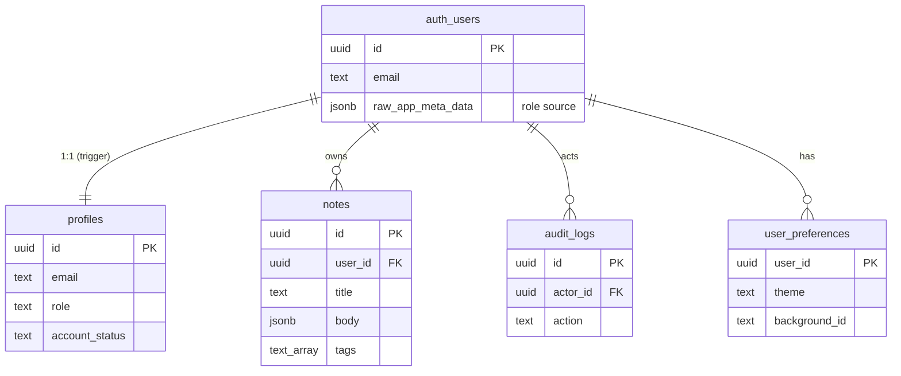
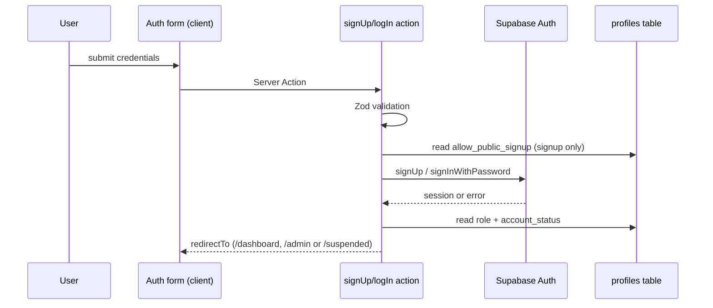
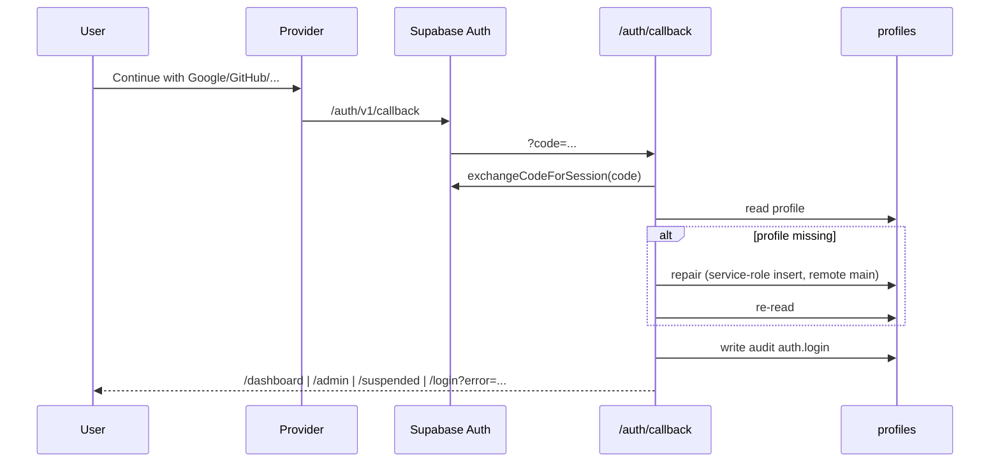
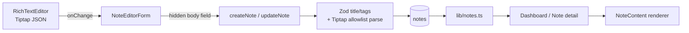

# UrSpace — Architecture

**Document status:** Phase 0 audit, 2026-11-26. Describes the implementation as
deployed at commit `4c24808`, with local-working-tree differences called out.

---

## 1. High-level architecture

UrSpace is a **server-rendered Next.js App Router application**. There is no
separate backend service. The backend is:

1. **Next.js Server Components and Server Actions** — rendering, authorization
   guards, validation and mutations.
2. **Supabase** — authentication (GoTrue), PostgreSQL with Row Level Security,
   and Storage for avatars.

The browser talks directly to Supabase only to start OAuth. Avatar uploads,
like every other mutation, go through a Server Action; everything else goes
through the server.

```mermaid
flowchart LR
  B[Browser]
  P[proxy.ts<br/>session refresh]
  R[Next.js App Router<br/>Server Components]
  A[Server Actions<br/>app/**/actions.ts]
  L[lib: guards, DALs,<br/>validation, parsing]
  S[Supabase Auth<br/>GoTrue]
  D[(PostgreSQL + RLS)]
  O[Storage: avatars]

  B -->|request| P --> R
  R --> L
  B -->|form submit| A --> L
  L -->|@supabase/ssr server client| S
  L -->|Data API + user JWT| D
  L -->|service-role client<br/>provisioning only| S
  B -->|signInWithOAuth| S
  L -->|avatar objects| O
```

---

## 2. Frontend structure

### 2.1 Route groups

| Group | Layout responsibility | Guard |
| --- | --- | --- |
| `(public)` | Landing, login, signup, password recovery, suspended, terms | None (some pages redirect signed-in users) |
| `(tutor)` | Theme + background providers, `AppShell`, header | `requireRole(["tutor"])` |
| `(account)` | Same shell, available to any active role | `requireUser()` |
| `(admin)` | Same shell | `requireStaff()` (owner or admin) |

Every guarded layout performs its async session read inside a `<Suspense>`
boundary. That is required by `cacheComponents: true`: reading cookies or
search params during prerender is otherwise a build error. Layouts are
Partial Prerender (`◐`) at build time.

### 2.2 Shared UI

- `components/app-shell.tsx` — header + `<main>` + footer chrome.
- `components/app-header.tsx` — brand, identity pill with avatar, and a settings
  gear dropdown containing the role-aware `NavLinks`, theme toggle and logout.
- `components/note-options-menu.tsx` — Notes-section options dropdown; hosts the
  writing-area wallpaper entry that opens the wallpaper dialog.
- `components/ui.tsx` — client primitives (`Button`, `Input`, `Alert`,
  `Spinner`, `EmptyState`, `Skeleton`, `SubmitButton`, `CurrentYear`).
- `components/motion.tsx` — motion primitives (`Reveal`, `Stagger`,
  `HoverLift`, `ParallaxScene`, `AnimatedNumber`, `RouteTransition`, `Enter`),
  all disabled under `prefers-reduced-motion`.
- `app/template.tsx` — wraps every navigation in `RouteTransition`.
- `app/globals.css` — design tokens, light/dark themes, editor and layout
  styles, reduced-motion neutralisation.

### 2.3 Styles and theming

- Tailwind v4 plus a custom token system in `app/globals.css`
  (`--surface*`, `--text*`, `--border*`, accent colours, radii, shadows).
- Theme is a `data-theme="light|dark"` attribute on `<html>`, bootstrapped
  before paint by an inline `next/script` in `app/layout.tsx`, then managed by
  `app/theme-provider.tsx` and persisted in `localStorage["urspace:theme"]`.
- Editor wallpapers are managed by `app/background-settings.tsx`, persisted in
  `localStorage["urspace:background"]`, and rendered by `NoteEditorBackdrop`
  inside `.note-editor-shell` only, behind a `--wallpaper-wash` dimmer. The layer
  is absolutely positioned and `object-fit: cover`, so it always fills the editor
  box. `AppBackdrop` renders the static themed `.app-background` layer with two
  ambient orbs.

**Current background scope:** only the note editor renders a photo. The provider
still wraps the `(tutor)`, `(account)` and `(admin)` shells so its trigger and
dialog are reachable, but no photo is drawn outside the editor (Phase 3A).

---

## 3. Backend structure

### 3.1 Server Actions

| File | Actions |
| --- | --- |
| `app/auth/actions.ts` | `signUp`, `logIn`, `logOut`, `requestPasswordReset`, `resetPassword` |
| `app/(tutor)/actions.ts` | `createNote`, `updateNote`, `deleteNote`, `importLocalNotes` |
| `app/(account)/actions.ts` | `updateDisplayName`, `changePassword`, `uploadAvatar`, `removeAvatar` |
| `app/(admin)/actions.ts` | `createAccount`, `setAccountStatus`, `updateAccountName`, `sendResetLink`, `adminUpdateNote`, `adminDeleteNote`, `updatePlatformSettings` |

Each action:
1. Re-authorizes (`requireStaff`, `requireOwner`, `getCurrentProfile`, or a
   local `activeProfile()` check that rejects missing/suspended accounts).
2. Validates with Zod (`lib/validation.ts`).
3. Re-checks the target (no self-modification, owner rows untouchable, admins
   limited to tutors).
4. Mutates through the **user's own** Supabase client, except account
   provisioning, which uses the service-role client.
5. Writes an audit entry for sensitive operations.
6. Revalidates affected paths.

### 3.2 Route handlers

| Route | Purpose |
| --- | --- |
| `/auth/callback` | OAuth code exchange → profile resolution → role routing |
| `/auth/confirm` | Email confirmation and password-recovery links → same handler |

Both re-export `handleAuthCallback` from `lib/auth-callback.ts`.

### 3.3 Library layer

| Module | Responsibility |
| --- | --- |
| `lib/supabase/client.ts` | Browser client (`createBrowserClient`) |
| `lib/supabase/server.ts` | Server client with cookie bridge (`getAll`/`setAll`) |
| `lib/supabase/admin.ts` | `server-only` service-role client; returns `null` when the key is absent |
| `lib/auth.ts` | `getCurrentProfile` (request-cached), `requireUser`, `requireRole`, `requireOwner`, `requireStaff` |
| `lib/auth-callback.ts` | Shared OAuth/email-link callback logic |
| `lib/notes.ts` | `getMyNotes`, `getMyNote`, `summarizeNotes` |
| `lib/admin.ts` | Paginated tutor/note/audit queries, admin stats, settings reads |
| `lib/note-document.ts` | Tiptap document parsing, node/mark allowlist, tag normalisation, link protocol allowlist, text extraction |
| `lib/validation.ts` | Zod schemas for every form |
| `lib/audit.ts` | `logAudit` (append-only, staff-readable) |
| `lib/types.ts` | `Role`, `Profile`, `NoteRow`, `DashboardNote`, `dashboardPathForRole`, `isStaff` |

### 3.4 Session refresh

`proxy.ts` runs on all routes except static assets. It creates a server client,
calls `supabase.auth.getUser()` (which validates the JWT with the auth server),
and writes refreshed cookies onto the response. Authorization itself is never
performed here; guards in layouts and actions do it, with RLS as the final
boundary.

---

## 4. Supabase integration

| Concern | Implementation |
| --- | --- |
| URL / anon key | `NEXT_PUBLIC_SUPABASE_URL`, `NEXT_PUBLIC_SUPABASE_PUBLISHABLE_KEY` |
| Server sessions | `@supabase/ssr` cookie adapter in `lib/supabase/server.ts` |
| Browser sessions | `@supabase/ssr` browser adapter in `lib/supabase/client.ts` |
| Privileged operations | Service-role client in `lib/supabase/admin.ts`, used only by admin account creation and (on remote `main`) the OAuth profile-repair fallback |
| Storage | Public `avatars` bucket; writes restricted to a folder named after the user's id |
| Images | `next.config.ts` allows the Supabase Storage public host |

Live project verified: `xwebcsemorzywsxdhtja`, region `eu-west-1`,
PostgreSQL 17.11, status `ACTIVE_HEALTHY`.

---

## 5. Database architecture

### 5.1 Tables (verified live)

| Table | Key columns | Purpose |
| --- | --- | --- |
| `profiles` | `id` → `auth.users.id` (PK, cascade), `email`, `display_name`, `avatar_url`, `role` (`owner`/`admin`/`tutor`), `account_status` (`active`/`suspended`), timestamps | Application identity, role and suspension state |
| `notes` | `id`, `user_id` → `auth.users.id` (cascade), `title`, `body jsonb`, `tags text[]`, timestamps | Note content; `body` is an allowlisted Tiptap JSON document |
| `audit_logs` | `id`, `actor_id` → `auth.users.id` (set null), `action`, `target_type`, `target_id`, `details jsonb`, `created_at` | Append-only audit trail |
| `platform_settings` | `key` (PK), `value jsonb`, `updated_at`, `updated_by` | Owner-controlled settings: `allow_public_signup`, `platform_notice` |
| `user_preferences` | `user_id` (PK, cascade), `theme`, `background_id`, `updated_at` | **Exists but unused by application code** |

Storage: one public bucket, `avatars`.

### 5.2 Functions and triggers (verified live)

| Object | Kind | Purpose |
| --- | --- | --- |
| `private.current_role()`, `private.is_active()`, `private.is_admin()`, `private.is_owner()` | `SECURITY DEFINER` SQL helpers in a non-exposed schema | RLS predicates without recursive policy evaluation |
| `public.handle_new_user()` | Trigger fn on `auth.users` after insert | Creates a profile; role from `app_metadata`, never `user_metadata` |
| `public.protect_profile_fields()` | Before update on `profiles` | Blocks changes to `id`/`email`; only the owner changes roles; staff limited to tutor suspension |
| `public.protect_note_owner()` | Before update on `notes` | Note ownership is immutable |
| `public.set_updated_at()` | Before update on four tables | Maintains `updated_at` |
| `public.ensure_profile()` | **NOT PRESENT in the live database** | Declared in the local, uncommitted `db/schema.sql` only |

Live triggers confirmed: `on_auth_user_created` (auth.users),
`profiles_protect_fields`, `profiles_set_updated_at`, `notes_protect_owner`,
`notes_set_updated_at`, `platform_settings_set_updated_at`,
`user_preferences_set_updated_at`.

### 5.3 Row Level Security (verified live: RLS enabled on all five tables)

| Table | Policies |
| --- | --- |
| `profiles` | select own **or** staff; update own (active only); update tutor rows (staff); update any (owner). No direct insert, no delete |
| `notes` | select/update/delete: own active row **or** staff on tutor-owned rows; insert: own active row only |
| `audit_logs` | insert own (active); select staff only |
| `platform_settings` | select public (`anon`, `authenticated`); insert/update owner only |
| `user_preferences` | own-row select/insert/update/delete |
| `storage.objects` | public read of `avatars`; insert/update/delete only inside the caller's own folder |

Total live policies: 21 (17 public + 4 storage).

### 5.4 Relationships



There is **no foreign key between `notes.user_id` and `profiles.id`** (both
reference `auth.users`), which is why `lib/admin.ts` joins notes to profiles
with a follow-up `.in()` query instead of an embedded PostgREST select.

---

## 6. Authentication flow

### 6.1 Email/password



- Signup writes `display_name` into `user_metadata`; the DB trigger creates the
  profile as `tutor` (role is read from `app_metadata`, which clients cannot
  set).
- Login failure returns exactly `"Wrong email or password"`; an
  `email_not_confirmed` error gets its own message.
- Password reset always returns a generic success message.
- Reset completion signs the user out and redirects to `/login?reset=1`.

### 6.2 OAuth and email links



- `next` is restricted to local paths (must start with `/`, not `//`).
- `?error=` → `/login?error=oauth`; missing/failed code → `/login?error=link`.
- `next=/reset-password` short-circuits to the reset form.
- On remote `main`, a missing profile triggers a **service-role insert** and,
  if that is impossible, `/login?error=profile`. On the local working tree, a
  different, uncommitted approach calls `ensure_profile()` (which does not
  exist in the database). See `KNOWN_ISSUES.md` KI-01.

### 6.3 Route protection

```mermaid
flowchart TD
  R[Request] --> P[proxy.ts refreshes session]
  P --> G{Layout guard}
  G -->|no user/profile| L[/login]
  G -->|suspended| S[/suspended]
  G -->|wrong role| D[role dashboard]
  G -->|authorised| C[render]
  C --> Q[Supabase query]
  Q --> RLS{RLS}
  RLS -->|allowed| OK[rows]
  RLS -->|denied| EMPTY[empty / error]
```

Authorization is enforced three times: server guards, RLS, and triggers.

---

## 7. Profile and role relationships

- `role` is the single source of truth for routing:
  `dashboardPathForRole` → `/admin` for `owner` and `admin`, `/dashboard` for
  `tutor`.
- `account_status` gates access at the guard, at the action layer and in RLS
  (`private.is_active()`).
- Role changes are owner-only (trigger). Admin creation is owner-only (server
  check + `createAccountSchema` explicitly rejects `owner`).
- `app_metadata.role` is the provisioning channel: the service-role
  `createUser` call sets it, and the signup trigger copies it into `profiles`.

---

## 8. Notes and workspace data flow



- Notes are **server-authoritative**. Mutations call a Server Action, then
  `router.refresh()`; there is no client-side cache as source of truth.
- Search and tag filtering run client-side over the tutor's fetched notes.
- Bodies are sanitised against a Tiptap node/mark allowlist on write and
  re-validated at render; links are restricted to `http`, `https`, `mailto`.
- Summaries (`total`, `thisWeek`, `tagCount`) are computed server-side.
- Legacy `localStorage` notes can be imported once, only when the account has
  no server notes.

### "Workspaces"

The brief refers to individual workspaces. **No workspace entity exists.**
Isolation is per user account: each tutor sees only their own notes; staff see
tutor notes. There is no shared workspace, membership table or note sharing.

---

## 9. Important application routes

| Route | Access | Rendering |
| --- | --- | --- |
| `/` | public | Partial Prerender |
| `/terms`, `/forgot-password`, `/reset-password` | public | Static |
| `/login`, `/signup`, `/suspended` | public (redirects signed-in users) | Partial Prerender |
| `/auth/callback`, `/auth/confirm` | public route handlers | Dynamic |
| `/dashboard` | tutor | Partial Prerender |
| `/notes/[id]` | tutor (own note) | Partial Prerender |
| `/profile` | any active role | Partial Prerender |
| `/settings` | any active role | Partial Prerender |
| `/admin` | owner/admin | Partial Prerender |
| `/admin/tutors`, `/admin/tutors/[id]` | owner/admin | Partial Prerender |
| `/admin/notes`, `/admin/notes/[id]` | owner/admin | Partial Prerender |
| `/admin/activity` | owner/admin | Partial Prerender |
| `/admin/settings` | owner only (action-enforced) | Partial Prerender |

Build output for the audited tree: **25 route entries**, no build errors.

---

## 10. How the major components interact

1. A request passes `proxy.ts`, which refreshes Supabase cookies.
2. The matching route-group layout renders a `<Suspense>` boundary whose child
   runs the appropriate guard (`requireUser` / `requireRole` / `requireStaff`).
3. Guards call `getCurrentProfile()`, which validates the JWT with
   `auth.getUser()` and reads `profiles`; it is request-cached with React
   `cache()` so multiple components share one lookup without caching across
   requests.
4. Pages call DAL functions (`lib/notes.ts`, `lib/admin.ts`) that scope queries
   by the caller's id while RLS enforces the same boundary.
5. Interactive forms are client components that submit Server Actions; actions
   re-authorize, validate, mutate, audit and revalidate.
6. `AppShell` supplies navigation, theme and background controls shared by the
   tutor, account and admin areas.

---

## 11. Phase 4 target architecture (designed, not implemented)

No route exists under `app/api/` and no provider adapter exists yet. The
design is in [API_DESIGN.md](API_DESIGN.md); the inventory and migration plan
are in [API_MIGRATION.md](API_MIGRATION.md).

The target is **API-driven across every module**, not notes-only:

| Layer | Responsibility |
| --- | --- |
| `app/api/v1/**` | Thin HTTP handlers: method, status, headers, one domain call |
| `lib/api/**` | Route wrapper, authentication context, role policies, error mapping, pagination, request id |
| `lib/domain/**` | Business rules: ownership, roles, validation orchestration, audit decisions |
| `lib/contracts/**` | Zod schemas and DTOs shared by browser, HTTP and services (provider-free) |
| `lib/ports/**` | Interfaces for auth, notes, profiles, settings, audit, storage, provisioning |
| `lib/providers/supabase/**` | The only place importing `@supabase/*`; SDK calls and error translation |
| `lib/api-client/**` | Browser `fetch` client and server in-process client over the same contract |

Key decisions:

- The browser talks to `/api/v1`; Server Components call the same domain
  in-process (no self-HTTP). Postman uses the HTTP contract.
- Authorization lives in the domain (explicit ownership and role checks). RLS
  remains defence-in-depth, so replacing the database cannot silently remove
  authorization.
- Authentication is an HttpOnly session cookie owned by the backend; OAuth moves
  from the browser SDK to a server redirect endpoint. A bearer token is a
  transitional bridge for Postman only.
- Modules: auth/session, me/profile/avatar, notes, public settings, admin
  overview/tutors/admins/notes/audit/settings.
- No schema, policy, feature or copy changes during the migration.

Server guards (`requireUser`/`requireRole`) redirect, so the API uses its own
authentication context helper. The three boundaries remain: route policy,
domain ownership check, RLS.
