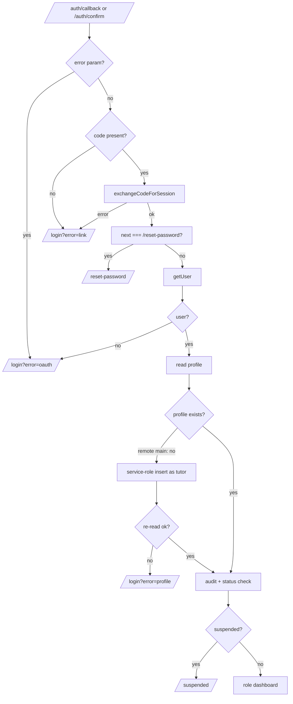

# UrSpace — Authentication

**Document status:** Phase 0 audit, 2026-11-26. Describes the implementation on
`origin/main` @ `4c24808` (deployed) and the live Supabase project
`xwebcsemorzywsxdhtja`. Local uncommitted differences are called out.

---

## 1. Summary of the model

| Concern | Implementation |
| --- | --- |
| Providers | Email/password; six OAuth buttons (Google, GitHub, Microsoft, Facebook, X, Apple) |
| Library | `@supabase/ssr` 0.12.7 with `@supabase/supabase-js` 2.119.0 |
| Session | Cookie-based Supabase session, refreshed in `proxy.ts` |
| Identity source of truth | `profiles` table (role, status), **not** `user_metadata` |
| Route guards | `requireUser`, `requireRole`, `requireOwner`, `requireStaff` |
| Database enforcement | RLS + `protect_profile_fields` trigger |
| Role routing | `/admin` for `owner`/`admin`, `/dashboard` for `tutor` |

---

## 2. Google OAuth implementation

**Code path**

1. `components/social-auth-buttons.tsx` (client) renders the Google button and calls:
   ```ts
   supabase.auth.signInWithOAuth({
     provider: "google",
     options: { redirectTo: `${window.location.origin}/auth/callback` },
   });
   ```
2. Supabase redirects to Google and back to
   `https://<project-ref>.supabase.co/auth/v1/callback`.
3. Supabase redirects the browser to `/auth/callback?code=…`.
4. `handleAuthCallback` exchanges the code, ensures a profile exists, audits the
   login and redirects by role.

**Configuration required (dashboard, not repository)**

- Supabase → Authentication → Providers → Google: enabled, with a Google Cloud
  OAuth 2.0 Web client ID/secret.
- Google authorised redirect URI:
  `https://xwebcsemorzywsxdhtja.supabase.co/auth/v1/callback`.
- Supabase → Authentication → URL Configuration → Redirect URLs must include
  `<site>/auth/callback`.

**Verified evidence**

- `auth.identities` contains **1 Google identity**, so Google sign-in has
  succeeded at least once at the Supabase layer.
- The Google button renders on `/login` and `/signup` (code inspection).
- A full browser round-trip (consent → callback → dashboard) was **not**
  performed in this audit. See `TESTING_CHECKLIST.md`.

---

## 3. GitHub OAuth implementation

Identical code path with `provider: "github"`. Supabase provider name is
`github`; a GitHub OAuth App must use
`https://xwebcsemorzywsxdhtja.supabase.co/auth/v1/callback` as its callback URL.

**Verified evidence:** `auth.identities` contains **1 GitHub identity**; the
button renders; full round-trip **unverified** in this audit.

### Other providers

Microsoft (`azure`), Facebook, X (`twitter`) and Apple buttons exist and are
wired identically. **No live identities exist for any of them.** They must be
treated as unverified and probably unconfigured until proven otherwise in
Phase 1. An unconfigured provider returns a Supabase error, and the UI shows
"Could not start {label} sign-in. Try again, or use email."

---

## 4. Authentication callback flow

`app/auth/callback/route.ts` and `app/auth/confirm/route.ts` both re-export
`handleAuthCallback` from `lib/auth-callback.ts`.



**Safety properties**

- `next` must start with `/` and not `//` — no open redirect.
- The exchange happens server-side; the session cookie is written by the
  Supabase server client.
- The audit entry records `method` (`oauth` or `email_link`) and the provider.

---

## 5. Profile creation

- Trigger `on_auth_user_created` on `auth.users` calls `public.handle_new_user()`.
- Role is read from `raw_app_meta_data->>'role'`, validated against
  `owner|admin|tutor`, defaulting to `tutor`. Public signups (email or OAuth)
  therefore always become tutors; only the service-role Admin API can set a
  different role.
- Display name precedence: `display_name` → `full_name` → `name` → email local
  part, truncated to 60 characters.
- The trigger is **verified present and enabled** in the live database.

**Live data mismatch:** 8 auth users exist but only **5 profile rows**. Three
auth users have no profile. This is the condition the recovery logic exists to
handle.

---

## 6. Profile recovery

Two competing implementations exist:

### A. Deployed (`origin/main` @ `4c24808`) — service-role insert

In `lib/auth-callback.ts`:

1. Read the profile with `maybeSingle()`.
2. If missing, `createAdminClient()` (service-role) inserts a row with
   `role: "tutor"`, `account_status: "active"`, display name from user metadata,
   avatar from `avatar_url` / `picture`.
3. A unique-violation (`23505`) from a concurrent callback is tolerated and the
   row is re-read.
4. Any other failure → `/login?error=profile`.
5. `app/(public)/login/page.tsx` shows a friendly alert for `error=profile`.

**This is the implementation Vercel deploys.** It **cannot work in production
today** because `SUPABASE_SERVICE_ROLE_KEY` is not set on the Vercel project
(see `KNOWN_ISSUES.md` KI-02).

### B. Local working tree only — `ensure_profile()` RPC

Uncommitted changes to `db/schema.sql`, `lib/auth.ts` and
`lib/auth-callback.ts` add a `SECURITY DEFINER` function
`public.ensure_profile()` that inserts a tutor profile for `auth.uid()`, call it
after code exchange and in `getCurrentProfile`, then re-read.

**Status: not active anywhere.**
- The function **does not exist** in the live database (verified).
- The change is staged but **not committed**.
- Its base for `lib/auth-callback.ts` is the *pre-fix* file, so committing it
  as-is would **revert** the deployed service-role recovery and the
  `error=profile` alert.

Do not merge this branch of work without reconciling it with `origin/main`.

### C. Password login with a missing profile

`app/auth/actions.ts` → `logIn` reads the profile after a successful password
sign-in and returns `"Wrong email or password"` when no profile row exists.
Consequence: the three auth users without profiles cannot use password login,
and the message is misleading (the password may be correct).

---

## 7. Role management

| Operation | Who | Mechanism |
| --- | --- | --- |
| Create tutor | owner, admin | Service-role `auth.admin.createUser` with `app_metadata.role = tutor` |
| Create admin | owner only | Same, `role = admin` (`createAccountSchema` rejects `owner`) |
| Create owner | nobody in-app | One-time SQL promotion: `db/owner-setup.sql` |
| Change role | owner only (DB trigger) | No UI exposes role changes |
| Suspend/reactivate tutor | owner or admin | `profiles.account_status` update, guarded by trigger + RLS |
| Rename account | owner or admin (tutors only) | `profiles.display_name` |
| Send reset link | owner or admin (tutors only) | `auth.resetPasswordForEmail` |

Upstream dashboard must have created an owner user (`db/owner-setup.sql`
mirrors the role into `app_metadata` and records an audit entry). **No owner
exists today.**

---

## 8. Dashboard routing

- `lib/types.ts` → `dashboardPathForRole(role)` returns `/admin` for staff and
  `/dashboard` for tutors.
- Applied in: `logIn` (action result), `handleAuthCallback`,
  `components/auth-redirect.tsx` (signed-in visitors on `/login`/`/signup`),
  `requireRole` (wrong-role bounce), `AppHeader` (home link).
- A suspended user is routed to `/suspended` from the callback and from
  `AuthRedirect`; guards redirect on every request.

---

## 9. Session management

- Cookie session managed by `@supabase/ssr`; refreshed in `proxy.ts` on every
  non-asset request.
- Server code uses `supabase.auth.getUser()`, which validates the JWT against
  the Auth server. `getSession()` is never used for authorization.
- `getCurrentProfile` is wrapped in React `cache()` — per-request only, so a
  role or suspension change is never served stale across requests.
- `server.ts` swallows cookie-write failures in Server Components (where
  cookies cannot be set) because the proxy handles refresh.
- Client sign-out calls `logOut`, which audits, signs out and redirects to `/`.

---

## 10. Suspended accounts

- `requireUser` redirects `account_status === "suspended"` to `/suspended`.
- `requireRole` inherits that behaviour.
- `requireStaff` / `requireOwner` therefore also block suspended staff.
- `logIn` returns `redirectTo: "/suspended"`; OAuth callback redirects there.
- All note/account actions reject suspended callers with a clear message.
- RLS: `private.is_active()` is part of the notes/profiles/audit policies, so a
  suspended session cannot read or write its own data even by direct API call.
- `/suspended` offers logout (if a profile is readable) or a link back to login.

Suspension rather than deletion preserves user data, as intended by the schema
comment.

---

## 11. Authentication error handling

| Situation | User-visible behaviour |
| --- | --- |
| Wrong email/password | `"Wrong email or password"` |
| Unconfirmed email on login | "Confirm your email address before logging in…" |
| Signup failure | Generic "Could not create the account…" (no email-existence leak) |
| Signup when confirmation is enabled | "Account created. Check your email…" |
| Reset request | Generic "If an account exists for that email…" |
| Invalid/expired reset link | `error=link` alert on `/login` |
| OAuth cancelled/provider error | "Social sign-in didn't complete…" (`error=oauth`) |
| OAuth completed but no profile | `error=profile` alert (deployed) / misleading login error (local tree) |
| Unconfigured social provider | "Could not start {label} sign-in. Try again, or use email." |
| Public signup disabled by owner | Signup refuses; social sign-up hidden on `/signup` |
| Unauthorized route | Redirect to `/login`; wrong role → own dashboard |

**Gap:** `/login` does not handle `error=profile` in the local tree (only on
remote `main`), and `logIn` does not attempt profile recovery.

---

## 12. Security considerations

- Role is never taken from `user_metadata` (user-editable); only
  `app_metadata` set by the service role.
- The service-role key is `server-only`, has no `NEXT_PUBLIC_` prefix, and is
  used by exactly two modules: `lib/supabase/admin.ts` (admin actions) and the
  OAuth callback on remote `main`.
- Protected profile fields are immutable outside trusted paths (trigger).
- Note ownership is immutable (trigger).
- RLS is enabled on every application table; `private` helpers are
  `SECURITY DEFINER` with `search_path = ''` and execute granted only to
  `authenticated`.
- `audit_logs` is append-only from the app's perspective (insert+select grants,
  no update/delete grants) and readable by staff only.
- Links in notes are protocol-allowlisted on write and render.
- Avatars validate MIME/size on both client and server; Storage policies limit
  writes to the caller's folder.
- Server actions re-authorize and re-check the target independently of the UI.

**Repository visibility:** GitHub metadata reported the repository as **public**.
That is acceptable only because secrets live in `.env.local` (gitignored) and
the Vercel dashboard. Any secret committed by accident would be public
immediately.

---

## 13. Known authentication problems

1. **No owner or admin account exists** → the admin area is unreachable.
2. **Service-role key missing on Vercel** → account provisioning fails and the
   deployed OAuth profile repair cannot run.
3. **Three auth users have no profile** → password login says "Wrong email or
   password"; OAuth login ends at `error=profile`.
4. **Local tree diverges from `origin/main`** with a superseded recovery
   approach that would revert the deployed fix.
5. **`error=profile` is not handled on `/login` in the local tree.**
6. **Duplicate Vercel project** with no env vars serves HTTP 500 on its alias,
   which can be mistaken for an application failure.
7. Unverified: whether Microsoft, Facebook, X and Apple providers are
   configured; whether Supabase's "Allow new users to sign up" toggle is on;
   whether the production Site URL / redirect allow-list includes the live
   domain.

All of the above are tracked in `KNOWN_ISSUES.md` with evidence and status.
